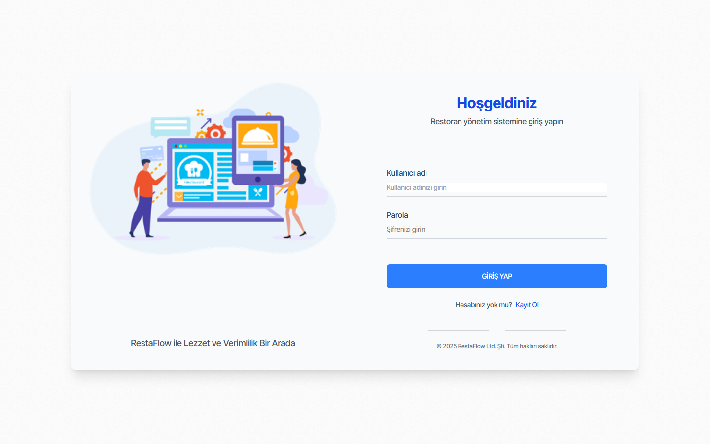
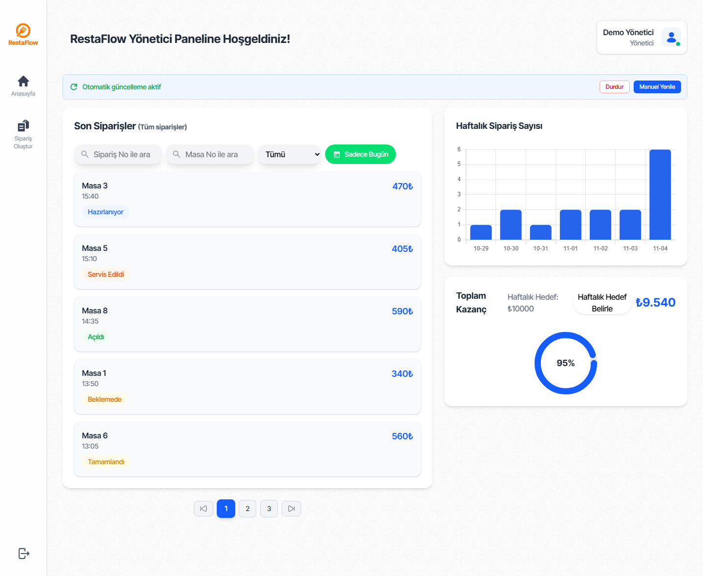
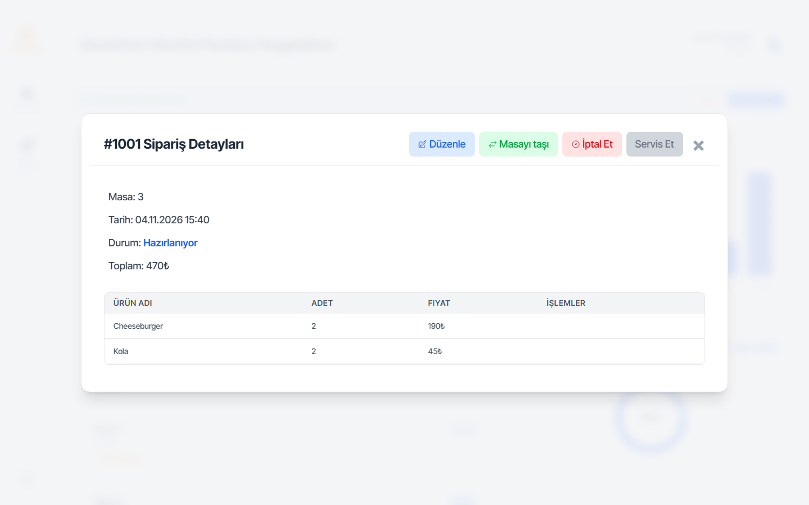
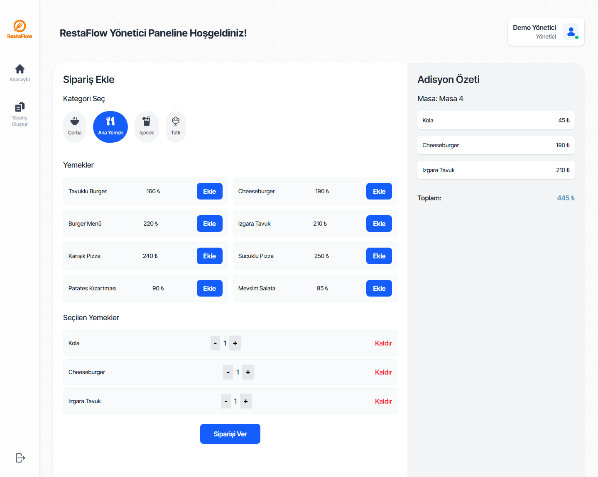

# 🍽️ RestaFlow – Restaurant Order & Staff Management System

RestaFlow is a full-stack restaurant management system developed to help restaurants manage orders, tables, and staff operations efficiently.

The system includes:

A Nuxt-based web interface

A fully functional desktop management panel

A custom-built backend API

All backend logic and desktop control mechanisms were developed from scratch.

## 🎯 Project Purpose

RestaFlow was built to:

Enable waiters to manage table-based orders quickly

Allow chefs to track and update order statuses

Provide administrators full operational control

Monitor real-time revenue and weekly performance

Manage restaurant staff and table organization efficiently

## 🖥️ Desktop Management Panel (Full Control System)

The desktop panel provides complete operational control over:

👨‍🍳 Staff Management

- Waiter management

- Chef management

- Role-based structure

- Staff-related order tracking

🪑 Table Management

- Real-time table status (Available / Occupied)

- Table transfer functionality

- Table-based order history

🧾 Order Management

Create, update, cancel orders

Increase/decrease item quantity

Move orders between tables

View detailed invoice (Adisyon) information

 📊 System Monitoring

Weekly order statistics

Revenue tracking

Target-based performance percentage

Live order updates

The desktop environment is designed to give full control over restaurant workflow and operations.

## 🌐 Web Interface

The web interface was developed using Nuxt and managed with pnpm.

Key Features:

Secure authentication system

Dynamic dashboard

Real-time order list

Category-based product selection (Soup, Main Course, Drinks, Dessert)

Live total calculation

Modern responsive UI

## 📸 Screenshots

### Sign in

Staff sign in as either a waiter (Garson) or an administrator (Yönetici). Waiters see only the orders they took; administrators see all orders and can set the weekly earnings target.

### Dashboard

Latest order per table with status filters, the weekly order chart and the weekly earnings target.

### Order details

### Create an order

Pick a table, a category and products; the order summary updates live.

## 🧩 Technologies Used
Frontend (Web)

* Nuxt
  
* Vue 3

## Desktop Panel

Custom-built control interface

Full operational management system

